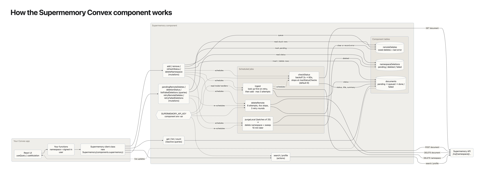

# Supermemory Convex component

[](https://www.npmjs.com/package/@waynesutton/convex-supermemory)

[](https://www.convex.dev/components/waynesutton/convex-supermemory)

<!-- START: Include on https://convex.dev/components -->

Give your Convex app long-term memory with
[Supermemory](https://supermemory.ai). Add text or URLs from a mutation. The
component sends them to Supermemory in the background, tracks processing status
in its own tables, and lets you search memories or read a user profile from any
action.

```ts
const supermemory = new Supermemory(components.supermemory);

// In a mutation: returns at once, ingestion runs in the background.
await supermemory.add(ctx, {
  namespace: userId,
  content: "Prefers short meetings before 10am",
});

// In a query: reactive, includes processing status.
const docs = await supermemory.list(ctx, { namespace: userId });

// In an action: recall.
const { results } = await supermemory.search(ctx, {
  namespace: userId,
  query: "when should we meet?",
});
```

What you get over calling the SDK yourself:

- **Writes from mutations.** `add` is a mutation, so it commits with the rest of
  your transaction. A scheduled action does the HTTP call.
- **Reactive status.** Each document moves through `pending`, `queued`,
  `extracting`, `embedding`, `done` or `failed` in a component table. `done`
  means the content is searchable. Memories form after that, tracked separately
  in `memoryStatus` (`pending`, `dreaming`, `done`). `useQuery` picks up every
  change.
- **Safe retries.** Timeouts and 5xx responses retry with backoff. Each attempt
  sends the full document, and Supermemory ignores a snapshot it already has, so
  a retry after a lost response doesn't duplicate content.
- **One document per thread.** Pass your own `id` and `add` updates that
  document instead of creating a new one. Send the full content each time;
  Supermemory only processes what changed.
- **Deletes that finish.** Removing a document or a whole namespace keeps a
  record until Supermemory confirms. Failures retry and stay visible until they
  succeed.
- **Bounded spend.** Status polling stops after a set number of checks.
  `maxProviderCallsForAdd()` tells you the worst-case call count so you can
  budget before calling.

[](https://raw.githubusercontent.com/waynesutton/supermemory-convex-component/main/docs/diagrams/how-the-component-works.png)

Click the diagram for the full-size image. There's also a
[PDF](docs/diagrams/how-the-component-works.pdf).

A community component by [Wayne Sutton](https://github.com/waynesutton). Not an
official Convex or Supermemory package.

**Live demo:**
[whimsical-buzzard-500.convex.site](https://whimsical-buzzard-500.convex.site).
The [Supermemory Convex component demo app](./example) runs anonymous sessions
with Turnstile, per-visitor quotas, a daily budget and an hourly reset. Its code
is a worked example of putting this component in front of the public.

## Installation

```sh
npm install @waynesutton/convex-supermemory
```

Install the component and pass it your Supermemory key. The key lives in the
component's own env var, so it never shows up in function arguments or scheduled
job records.

```ts
// convex/convex.config.ts
import { defineApp } from "convex/server";
import { v } from "convex/values";
import supermemory from "@waynesutton/convex-supermemory/convex.config.js";

const app = defineApp({
  env: { SUPERMEMORY_API_KEY: v.optional(v.string()) },
});

app.use(supermemory, {
  env: { SUPERMEMORY_API_KEY: app.env.SUPERMEMORY_API_KEY },
});

export default app;
```

```sh
npx convex env set SUPERMEMORY_API_KEY sm_...
```

Requires `convex` 1.49 or later for component env vars.

## Usage

```ts
// convex/memory.ts
import { v } from "convex/values";
import { Supermemory, vDocument } from "@waynesutton/convex-supermemory";
import { components } from "./_generated/api";
import { action, mutation, query } from "./_generated/server";
import { getAuthUserId } from "@convex-dev/auth/server";

const supermemory = new Supermemory(components.supermemory, {
  maxStatusChecks: 8,
});

export const remember = mutation({
  args: { content: v.string() },
  handler: async (ctx, args) => {
    const userId = await getAuthUserId(ctx);
    if (!userId) throw new Error("Not signed in");
    return await supermemory.add(ctx, {
      namespace: userId,
      content: args.content,
    });
  },
});

export const myMemories = query({
  args: {},
  returns: v.array(vDocument),
  handler: async (ctx) => {
    const userId = await getAuthUserId(ctx);
    if (!userId) return [];
    return await supermemory.list(ctx, { namespace: userId });
  },
});

export const recall = action({
  args: { query: v.string() },
  handler: async (ctx, args) => {
    const userId = await getAuthUserId(ctx);
    if (!userId) throw new Error("Not signed in");
    return await supermemory.search(ctx, {
      namespace: userId,
      query: args.query,
    });
  },
});
```

**Namespaces are the security boundary.** The component scopes every read,
delete and search to the namespace you pass, and it trusts that value. Derive it
from the authenticated user on the server. Never accept one from the browser.

## API

| Method                                                                                                         | Context          | What it does                                                                                                                                                                                          |
| -------------------------------------------------------------------------------------------------------------- | ---------------- | ----------------------------------------------------------------------------------------------------------------------------------------------------------------------------------------------------- |
| `add(ctx, { namespace, content, requestId?, title?, metadata?, maxStatusChecks?, id?, dreaming?, taskType? })` | mutation         | Queues text or a URL. Returns `{ documentId, deduplicated }`. A repeated `requestId` returns the first document. A repeated `id` updates that document with the new full content                      |
| `get(ctx, { namespace, documentId })`                                                                          | query            | One document, or `null` if it isn't in that namespace                                                                                                                                                 |
| `list(ctx, { namespace, limit? })`                                                                             | query            | Newest first, up to 100                                                                                                                                                                               |
| `count(ctx, { namespace, max? })`                                                                              | query            | Documents in a namespace, up to `max`                                                                                                                                                                 |
| `remove(ctx, { namespace, documentId })`                                                                       | mutation         | Deletes locally now and remotely in the background                                                                                                                                                    |
| `refreshStatus(ctx, { namespace, documentId })`                                                                | mutation         | One more status check for a document still processing                                                                                                                                                 |
| `search(ctx, { namespace, query, limit?, searchMode?, threshold?, rerank?, rewriteQuery?, filter? })`          | action           | Hybrid search by default. Returns `{ results, searchTime }`                                                                                                                                           |
| `profile(ctx, { namespace, buckets?, filter? })`                                                               | action           | `{ static, dynamic, buckets }` memories Supermemory keeps for the namespace                                                                                                                           |
| `memoryContext(ctx, { namespace, query?, limit?, filter? })`                                                   | action           | Profile plus memories relevant to `query` as one `{ role: "system", content }` message, or `null`                                                                                                     |
| `saveThread(ctx, { namespace, threadId, messages, metadata?, dreaming? })`                                     | mutation         | Saves a conversation as one document per thread (`id: thread_<threadId>`)                                                                                                                             |
| `deleteNamespace(ctx, { namespace, remote? })`                                                                 | mutation         | Deletes this component's documents locally and in Supermemory, with retries. Data written to the namespace by anything else is kept. `remote: "namespace"` deletes the whole remote namespace instead |
| `deletionStatus(ctx, { namespace })`                                                                           | query            | `pending`, `deleted` or `failed`                                                                                                                                                                      |
| `listFailedDeletions(ctx)` / `retryFailedDeletions(ctx)`                                                       | query / mutation | Find and retry namespace deletes that ran out of attempts                                                                                                                                             |
| `pendingRemoteDeletes(ctx, { namespace })` / `retryRemoteDeletes(ctx, { namespace })`                          | query / mutation | Same, for single-document deletes                                                                                                                                                                     |

Exports for your own validators and budgets: `vDocument`, `vSearchResult`,
`vMemoryItem`, `vDocumentStatus`, `maxProviderCallsForAdd`,
`MAX_CONTENT_LENGTH`, `MAX_QUERY_LENGTH`, `NAMESPACE_PATTERN`.

Namespaces are 1 to 128 letters, digits, `_` or `-`. Content is capped at 50,000
characters per document, and `list` returns at most 100.

## Use with the Convex Agent component

Inject memories into every prompt with a `contextHandler`, and save the thread
after each turn. Derive `namespace` from the signed-in user.

```ts
const agent = new Agent(components.agent, {
  languageModel: openai.chat("gpt-5"),
  contextHandler: async (ctx, args) => {
    const memory = await supermemory.memoryContext(ctx, {
      namespace: args.userId!,
      query: args.inputPrompt
        .map((m) => (typeof m.content === "string" ? m.content : ""))
        .join(" "),
    });
    return memory ? [memory, ...args.allMessages] : args.allMessages;
  },
});

// After a turn, from a mutation: one Supermemory document per thread.
await supermemory.saveThread(ctx, {
  namespace: userId,
  threadId,
  messages: messages.map((m) => ({ role: m.role, content: m.text ?? "" })),
});
```

## How it handles failure

| Situation                                  | What happens                                                                                         |
| ------------------------------------------ | ---------------------------------------------------------------------------------------------------- |
| Timeout, 408, 429 or 5xx on ingest         | Retries up to 3 attempts with backoff, re-sending the same full content                              |
| 4xx on ingest                              | Marked `failed` with a short error like `Supermemory returned 401`. Response bodies are never stored |
| Document deleted while ingest is in flight | The late result queues a remote delete, so the content doesn't linger                                |
| `add` while its namespace is being deleted | Rejected until the delete finishes                                                                   |
| Remote delete fails                        | Retries up to 8 times, then stays listed in `pendingRemoteDeletes` until `retryRemoteDeletes`        |
| Status never reaches `done`                | Polling stops at `maxStatusChecks`. `refreshStatus` buys one more                                    |
| Content `done`, memories still forming     | Polling continues every 2.5 minutes until `memoryStatus` is `done`, within `maxStatusChecks`         |
| `add` with an `id` while it is ingesting   | The newer content is sent after the in-flight attempt finishes, never out of order                   |

`search` and `profile` call Supermemory directly. Rate limit them in your app.
The demo shows one way with
[`@convex-dev/rate-limiter`](https://www.convex.dev/components/rate-limiter).

## Testing with convex-test

```ts
import { convexTest } from "convex-test";
import supermemoryTest from "@waynesutton/convex-supermemory/test";

const t = convexTest(schema, modules);
supermemoryTest.register(t, "supermemory");
```

Stub `fetch` to fake Supermemory. `src/testing/fakeSupermemory.ts` in this repo
is a working example.

<!-- END: Include on https://convex.dev/components -->

## Run the demo locally

```sh
npm install
cp .env.example .env.local     # then fill in values, see below
npm run dev                    # Convex backend plus component codegen
npm run dev:frontend           # Vite on http://localhost:5173
```

The demo needs these on the Convex deployment:

```sh
npx convex env set SUPERMEMORY_API_KEY sm_...
npx convex env set TURNSTILE_SECRET_KEY 1x0000000000000000000000000000000AA   # Cloudflare's always-pass test key
npx convex env set SITE_URL http://localhost:5173
node scripts/generate-auth-keys.mjs   # prints JWT_PRIVATE_KEY and JWKS to set the same way
```

See [docs/demo.md](docs/demo.md) for every limit, the reset schedule, and the
production checklist.

## Development

```sh
npm run test        # component and demo tests
npm run typecheck
npm run lint
npm run build
```

## License

MIT. See [LICENSE](LICENSE).
